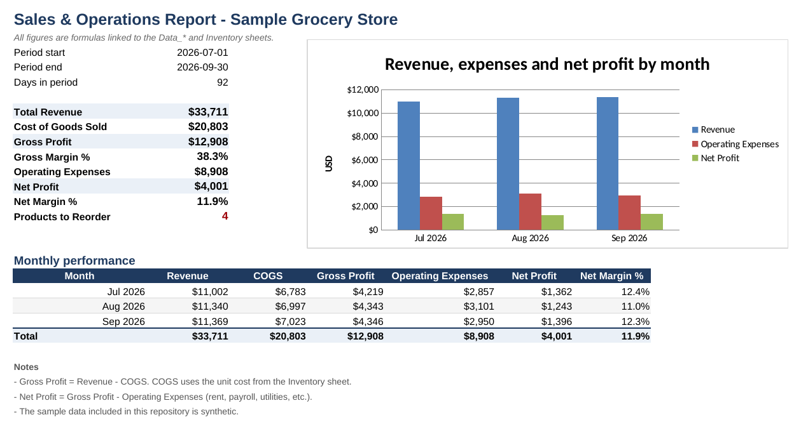
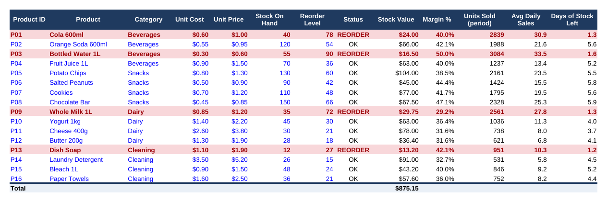

# Sales & Operations Report Generator

Turn three CSV files (sales, expenses, inventory) into a ready-to-share Excel
report: monthly profit and loss, sales by category, product ranking, expense
breakdown and an inventory sheet that flags what you need to reorder.

Built for small businesses that still build this report by hand every month.
Written in Python (pandas + openpyxl).



## What the report includes

| Sheet | What it shows |
|---|---|
| **Summary** | Revenue, COGS, gross profit, operating expenses, net profit and margins, a monthly table and a chart |
| **Sales_by_Category** | Revenue by category and month, share of total, gross margin by category, chart |
| **Product_Ranking** | Every product ranked by revenue, with units, gross profit and margin, plus a top-10 chart |
| **Expense_Breakdown** | Spending by category and month, share of total, chart |
| **Inventory** | Stock status, reorder alerts (highlighted in red), stock value, average daily sales and days of stock left |
| **Data_Sales / Data_Expenses** | The cleaned input data, with helper columns (revenue, COGS, gross profit) |



## Quick start

```bash
git clone <this-repo-url>
cd sales-report-generator
pip install -r requirements.txt
python report_generator.py
```

The report is saved to `output/sales_report.xlsx`. The repository includes
synthetic sample data for a small grocery store (July to September 2026), so it
works out of the box.

## Use your own data

```bash
python report_generator.py \
  --sales my_sales.csv \
  --expenses my_expenses.csv \
  --inventory my_inventory.csv \
  --output my_report.xlsx \
  --store-name "My Store"
```

Your CSV files need these columns:

| File | Columns |
|---|---|
| **sales** | `date`, `product_id`, `product`, `category`, `units`, `unit_price` |
| **expenses** | `date`, `category`, `description`, `amount` |
| **inventory** | `product_id`, `product`, `category`, `unit_cost`, `unit_price`, `stock_on_hand`, `reorder_level`, `supplier` |

Dates should look like `2026-07-31`. Every `product_id` in the sales file must
exist in the inventory file, because the cost of goods sold is looked up from
the inventory sheet.

If something is wrong with a file, the script stops with a clear message instead
of producing a broken report. For example:

```
Error: sales.csv is missing columns: product, category, units, unit_price
```

## How it works

1. **Load and validate.** `pandas` reads the CSVs and checks columns, dates,
   numbers and product IDs.
2. **Build the workbook.** `openpyxl` writes the data sheets and the report sheets.
3. **Formulas, not pasted numbers.** Every figure in the report sheets is an Excel
   formula (`SUMIFS`, `INDEX/MATCH`, `COUNTIF`...) that points to the data
   sheets. If someone edits a sale or an expense in the workbook, the totals and
   charts update by themselves.

I chose formulas on purpose: a client can audit any number by clicking on it,
and they can keep using the file after the script has run.

## Project structure

```
sales-report-generator/
├── report_generator.py       # main script: CSV -> Excel report
├── generate_sample_data.py   # recreates the synthetic sample data
├── data/                     # sample CSV files
├── output/sales_report.xlsx  # example report
├── docs/                     # screenshots used in this README
└── requirements.txt
```

## Notes and limitations

- The sample data is **synthetic**. It does not come from any real business.
- Formulas are calculated when the file is opened in Excel or LibreOffice. The
  example in `output/` was already recalculated, so it also shows values in
  viewers that do not calculate formulas.
- Products and expense categories are sorted by amount **when the report is
  generated**. If you change the data inside the workbook, the numbers update
  but the order does not. Run the script again to re-sort.
- The report is in English and uses `$` as the currency symbol.

## Possible next steps

- Export a PDF summary for the owner.
- Add a configuration file for custom thresholds (for example, 5 days of stock
  instead of the supplier lead time).
- Read the data directly from an Excel file or a point-of-sale export.

## Author

Diego Mejía M. Actuarial Science student. I build Python and Excel automations
for reports, expense tracking and inventory.
